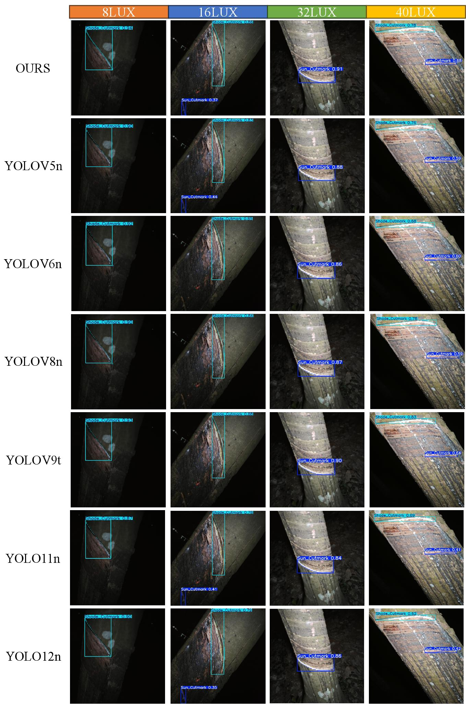
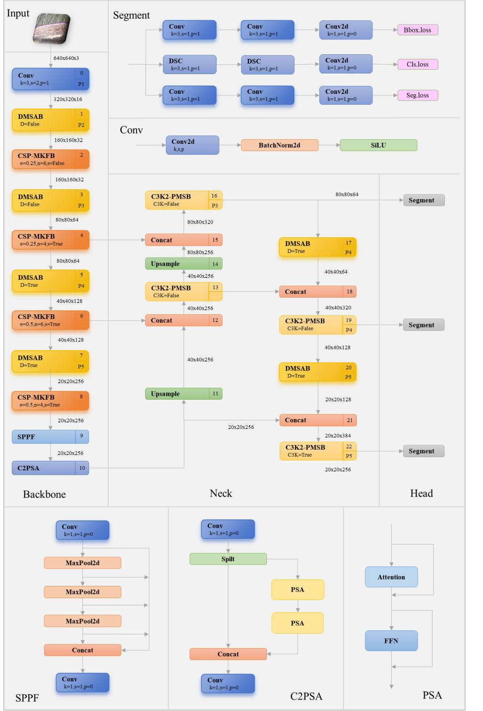
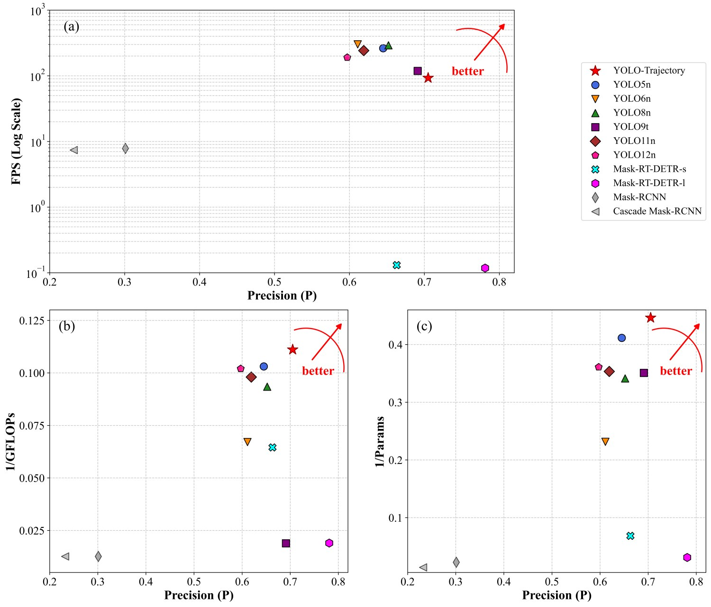

<div align="center">

# YOLO-Trajectory

### A Nighttime Low-Light Rubber Tapping Trajectory Segmentation Model for Rubber-Tapping Robots

[](https://www.python.org/)
[](https://pytorch.org/)
[](https://github.com/ultralytics/ultralytics)
[](LICENSE)
[](#citation)

**Official implementation of YOLO-Trajectory** — an end-to-end, real-time model that segments thin, curved rubber-tapping trajectories from images captured in **nighttime low-light** environments, enabling autonomous rubber-tapping robots to see and follow the cut path.

</div>

---

## 🌙 Highlights

<div align="center">



*Segmentation results under illumination levels from **0 lx** to **40 lx**. Dark blue curves are the sun-facing cut paths and light blue curves are the shade-facing cut paths (best viewed zoomed).*

</div>

| | |
| :--- | :--- |
| 🦾 **Task** | End-to-end instance segmentation of slender, curved tapping trajectories |
| 💡 **Setting** | Nighttime low-light (0 – 40 lux), dense thin structures |
| ⚡ **Efficiency** | **2.24 M** parameters · **9.0 GFLOPs** · **92.8 FPS** |
| 🎯 **Accuracy** | mAP50 = **0.612**, mAP50-95 = **0.184** (paper) |
| 🧩 **Backbone** | Official Ultralytics **YOLO11** + three lightweight paper modules |

---

## 🧠 Architecture

<div align="center">



*Overall architecture of YOLO-Trajectory. Three novel modules (highlighted) replace the standard YOLO11 components for thin-structure and low-light feature extraction.*

</div>

The model is configured by [`ultralytics/cfg/models/11/yolo-trajectory.yaml`](ultralytics/cfg/models/11/yolo-trajectory.yaml) (nano scale by default; scale `n/s/m/l/x` like stock YOLO11).

| Module (paper) | Class (code) | File | Role |
| :--- | :--- | :--- | :--- |
| **DMSAB** — Dilated Multi-branch Shared Attention Block | `DMSAB` | [`ultralytics/nn/modules_paper/dmsab.py`](ultralytics/nn/modules_paper/dmsab.py) | Dilated downsampling + shared attention for low-light cues |
| **CSP-MKFB** — Cross Stage Partial Bottleneck with Multi-Kernel Fusion Block | `CSP_MKFB` (`MKFB`, `SUIB`) | [`ultralytics/nn/modules_paper/csp_mkfb.py`](ultralytics/nn/modules_paper/csp_mkfb.py) | Backbone block: multi-kernel fusion + Star (SUIB) inverted bottleneck |
| **PMSB** — Partial Multi-Scale Bottleneck | `C3k2_PMSB` | [`ultralytics/nn/modules_paper/c3k2_pmsb.py`](ultralytics/nn/modules_paper/c3k2_pmsb.py) | Neck block: partial multi-scale fusion for elongated curved lines |

---

## 📊 Results

### Paper results (Table 5 — nighttime low-light benchmark)

| Model | P | R | mAP50 | mAP50-95 | Params | GFLOPs | FPS |
| :--- | :---: | :---: | :---: | :---: | :---: | :---: | :---: |
| YOLOv5n | 0.645 | 0.639 | 0.528 | 0.157 | 2.43 M | 9.7 | 262.9 |
| YOLOv6n | 0.611 | 0.622 | 0.484 | 0.142 | 4.32 M | 14.9 | 301.7 |
| YOLOv8n | 0.652 | 0.641 | 0.533 | 0.165 | 2.93 M | 10.7 | 291.9 |
| YOLOv9t | 0.691 | 0.683 | 0.597 | 0.185 | 2.85 M | 52.9 | 118.6 |
| YOLO11n | 0.619 | 0.606 | 0.499 | 0.142 | 2.83 M | 10.2 | 242.5 |
| YOLO12n | 0.597 | 0.595 | 0.457 | 0.128 | 2.77 M | 9.8 | 190.7 |
| Mask R-CNN | 0.301 | 0.285 | 0.125 | 0.024 | 43.99 M | 78.98* | 7.84 |
| Mask-RT-DETR-l | 0.781 | 0.735 | 0.658 | 0.188 | 32.17 M | 52.56* | 0.12 |
| **YOLO-Trajectory** | **0.705** | **0.701** | **0.612** | **0.184** | **2.24 M** | **9.0** | **92.8** |

> **mAP50 = 0.612** — +11.3 % over YOLO11n and +15.5 % over YOLO12n — with the **lowest GFLOPs (9.0)** among all compared models.
>
> \* GFLOPs estimated with PaddleDetection `paddleslim`.

<div align="center">

<br/>
<sub>Efficiency comparison: YOLO-Trajectory achieves the best accuracy–cost trade-off (lowest GFLOPs and parameter count).</sub>
</div>

---

## 🚀 Installation

```bash
git clone https://github.com/<your-org>/YOLO-Trajectory.git
cd YOLO-Trajectory
pip install -e .
```

Requires Python ≥ 3.9 and PyTorch ≥ 2.0 (see [`pyproject.toml`](pyproject.toml)).

Smoke test with the built-in COCO8-segment subset:

```bash
python train.py   # data=coco8-seg by default
```

---

## 📁 Dataset

The 2 072-image nighttime low-light dataset (**2 classes**: sun-facing / shade-facing cut path) will be released on ScienceDB (under review; DOI pending registration): `10.57760/sciencedb.016en`.

```bibtex
@misc{95074d9e10ab4ecaaf235445f466b36b,
  author       = {Chenhui Wei and Zhifu Zhang},
  title        = {{Nighttime Low-Light Rubber Tapping Trajectory Dataset}},
  version      = {V1},
  doi          = {10.57760/sciencedb.016en},
  url          = {https://doi.org/10.57760/sciencedb.016en},
  year         = {2026}
}
```

After download, place it under `datasets/dark-xj` and point the template at it:

```yaml
# ultralytics/cfg/datasets/dark-xj-seg.yaml
path: ../datasets/dark-xj
train: images/train
val: images/val
test: images/test
names:
  0: Sun-facing cut path
  1: Shade-facing cut path
```

---

## 🏋️ Train / Val / Predict

```bash
# Train YOLO-Trajectory (nano scale by default; edit the yaml for s/m/l/x)
python train.py

# Validate
python val.py

# Inference
python predict.py
```

Programmatic API (standard Ultralytics workflow):

```python
from ultralytics import YOLO

model = YOLO("ultralytics/cfg/models/11/yolo-trajectory.yaml")
model.train(data="ultralytics/cfg/datasets/dark-xj-seg.yaml", task="segment",
            imgsz=640, epochs=200, batch=16)
```

Stock YOLO11 configs (`yolo11.yaml`, `yolo11-seg.yaml`, …) remain under `ultralytics/cfg/models/11/` for baseline training.

---

## 🗂 Project layout

```
train.py / val.py / predict.py        # clean entry points
ultralytics/
  cfg/models/11/yolo-trajectory.yaml  # paper model config
  cfg/datasets/dark-xj-seg.yaml       # dataset template
  nn/modules_paper/                   # DMSAB · CSP_MKFB · C3k2_PMSB
  models/yolo/segment/                # segmentation pipeline
```

---

## 📜 License

This repository is released under the [AGPL-3.0 license](LICENSE), inherited from [Ultralytics YOLO](https://github.com/ultralytics/ultralytics). If you prefer a commercial license for closed-source deployment, see [Ultralytics licensing](https://www.ultralytics.com/license).

---

## 📖 Citation

If you use this code, please cite the original paper (currently under review — no DOI assigned yet), and if you use the dataset, please cite it via its DOI:

```bibtex
@article{zhang2025yolotrajectory,
  title   = {A Nighttime Low-Light Rubber Tapping Trajectory Segmentation Model for Rubber-Tapping Robots},
  author  = {Zhang, Zhifu and Wei, Chenhui and Li, Yue and Liu, Junxiao and Zhang, Xirui},
  year    = {2025},
  note    = {Under review}
}

@misc{95074d9e10ab4ecaaf235445f466b36b,
  author       = {Chenhui Wei and Zhifu Zhang},
  title        = {{Nighttime Low-Light Rubber Tapping Trajectory Dataset}},
  version      = {V1},
  doi          = {10.57760/sciencedb.016en},
  url          = {https://doi.org/10.57760/sciencedb.016en},
  year         = {2026}
}
```

---

## 🙏 Acknowledgement

This codebase is built upon [Ultralytics YOLO](https://github.com/ultralytics/ultralytics). We thank the open-source community for tools used in evaluation and deployment.
